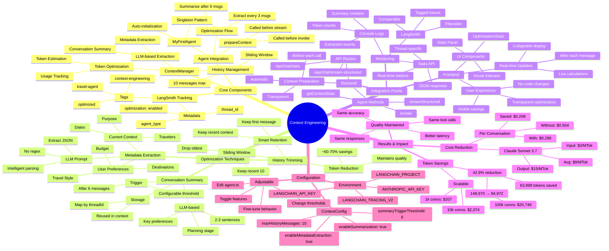
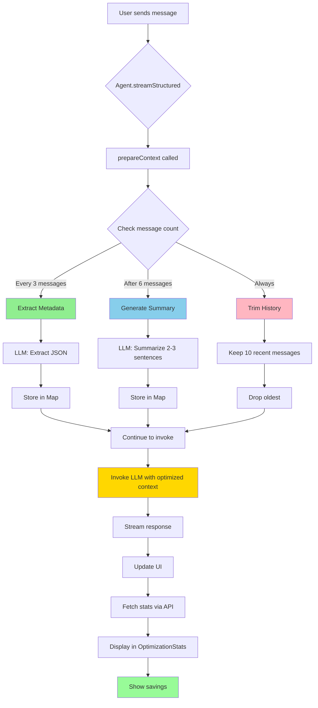
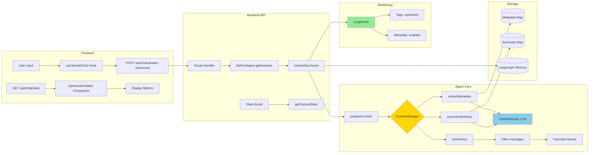
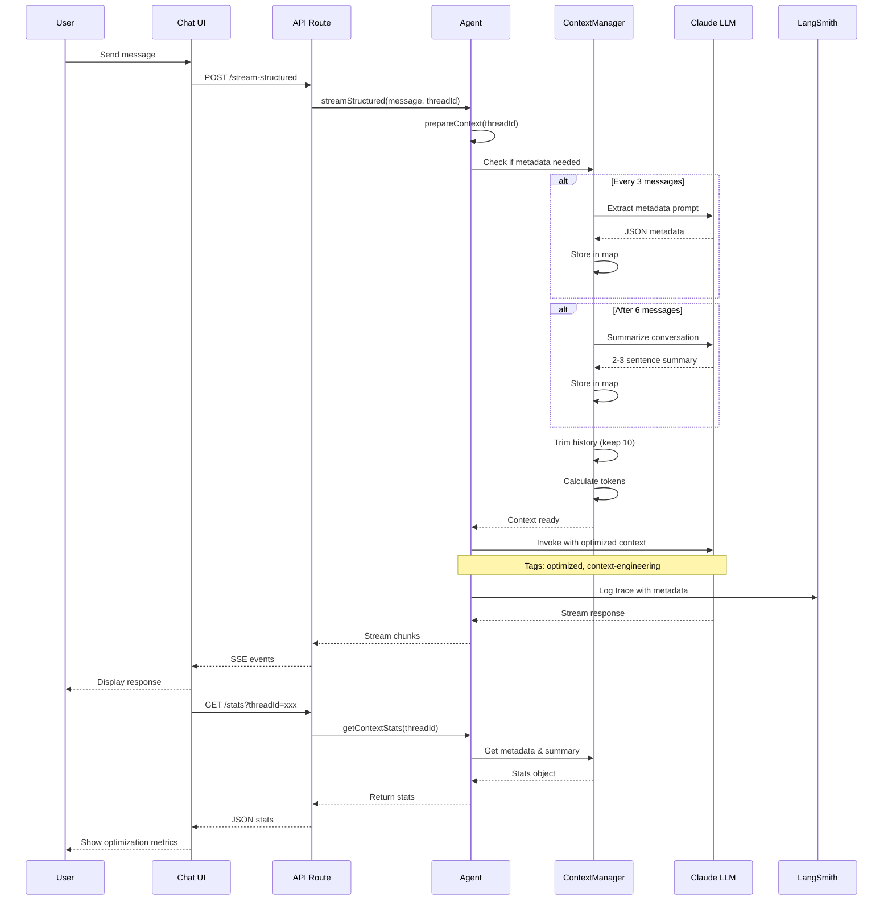
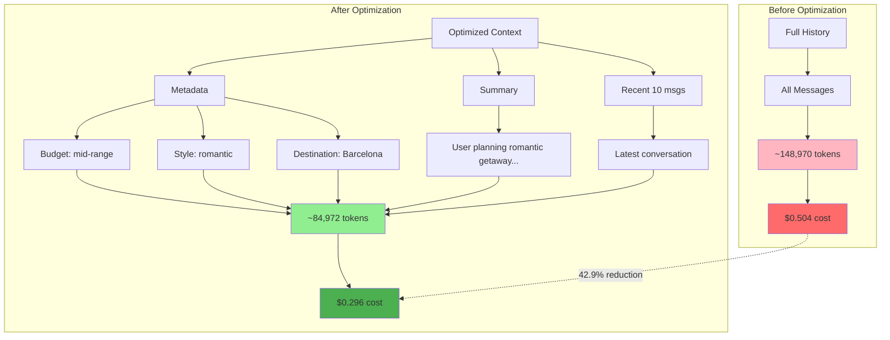
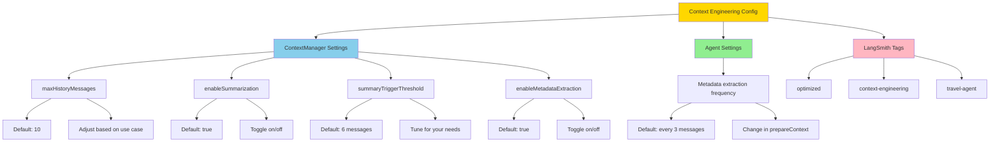

# 🧠 Context Engineering - Architecture Mindmap

## System Overview

## Detailed Flow Diagram

## Data Flow Architecture

## Component Interaction

## Token Optimization Strategy

## Configuration & Tuning

---

## Key Takeaways

### 🎯 Core Principle
**Reduce token usage while maintaining conversation quality through intelligent context management**

### 🔑 Key Techniques
1. **LLM-based Metadata Extraction** - Smart, not regex-based
2. **Conversation Summarization** - Concise context preservation
3. **Sliding Window History** - Keep only relevant messages
4. **Token Estimation** - Real-time monitoring

### 💡 Benefits
- **42.9% token reduction** (148,970 → 84,972)
- **41.2% cost reduction** ($0.504 → $0.296)
- **Maintains quality** - Same responses, better efficiency
- **Transparent** - Works automatically, visible in UI

### 🚀 Scalability
- **1,000 conversations**: Save $207.46
- **10,000 conversations**: Save $2,074.62
- **100,000 conversations**: Save $20,746.20

---

**Context Engineering: Smart optimization for production AI agents** 🧠✨
